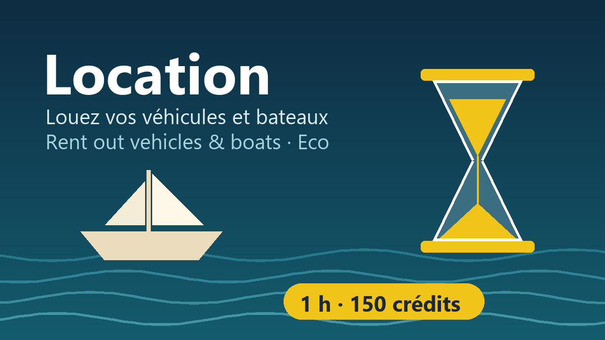

<p align="center"></p>

<p align="center"><a href="https://github.com/sponsors/nicolabcraft"></a></p>

# Location : louez vos véhicules dans Eco

Mod serveur pour **Eco** (Strange Loop Games) : les joueurs peuvent louer un
véhicule ou un bateau à son propriétaire, pour une durée choisie et un prix par
heure (par exemple 1 h pour 150 crédits). La location est une **action de jeu** :
vos lois peuvent la taxer ou l'interdire.

*[English below](#english)* · [Changelog](CHANGELOG.md) · [Contribuer / Contributing](CONTRIBUTING.md)

Disponible en **anglais** et en **français** (selon la langue de chaque joueur),
et traduisible dans toute langue d'Eco : voir [Traduire](CONTRIBUTING.md#traduire).

## Fonctionnement

**Propriétaire**, dans l'onglet **Louer** du véhicule (*Vehicle Rental* en anglais) :

- cochez *Proposer à la location* ;
- fixez le *Prix par heure*, la *Devise* et le *Compte qui encaisse* ;
- fixez la *Durée maximale* (1 à 168 heures, 24 par défaut) ;
- *Mettre fin à la location* reprend le véhicule à tout moment.

Gardez l'autorisation du véhicule **fermée** (pas « Tout le monde ») : la
location ouvre l'accès au seul locataire, le temps de la location.

**Locataire**, sans aucun accès au véhicule :

- visez le véhicule et faites **Ctrl + clic droit : « Louer (150 Crédits / h) »** ;
- choisissez une durée (1 h · 150, 2 h · 300…) : le prix est payé depuis votre compte personnel ;
- pendant la location, conduisez et utilisez la **cale** (prendre et déposer) ;
- l'onglet *Louer* permet de **prolonger** ou de **rendre maintenant**.

Le locataire est prévenu 5 minutes puis 1 minute avant la fin. À l'échéance, il
perd l'accès et descend du véhicule. Il ne reçoit que l'accès « consommateur » :
il ne peut ni ramasser le véhicule ni changer ses droits. Le temps compte en
temps de monde et s'arrête quand le serveur est éteint.

## Lois

Chaque location et chaque prolongation déclenche l'action **LouerObjet**
(« Louer un objet », catégorie Finance) :

| Champ | Contenu |
|---|---|
| `Locataire` | le citoyen qui loue |
| `Proprietaire` | le propriétaire du véhicule |
| `ObjetLoue` | le type de véhicule |
| `Heures` | la durée louée |
| `PrixParHeure` | le prix demandé pour une heure |
| `CurrencyAmount`, `Currency` | le montant payé et la devise |
| `SourceBankAccount`, `TargetBankAccount` | les comptes du locataire et du propriétaire |
| `ActionLocation` | l'endroit où se trouve le véhicule |

Exemples : une taxe de 10 % sur `CurrencyAmount`, ou l'interdiction de louer
les bateaux avec une condition sur `ObjetLoue`. Si une loi refuse, ou si le
paiement échoue, rien ne se passe.

## Installation

Téléchargez `Location-<version>.zip` dans les [Releases](../../releases) et
décompressez-le **à la racine du serveur**, puis redémarrez. Pas de DLL, pas de
réglage :

```
Mods/UserCode/Location/*.cs        le mod (compilé par le serveur au démarrage)
Mods/Translations/Location.csv     ses traductions
```

Avec l'abonnement mod.io, le serveur installe le mod dans `Mods/UserCode/mod.io/` :
copiez alors `Location.csv` dans `Mods/Translations/` pour les traductions. Ne
cumulez pas les deux installations : les fichiers seraient compilés deux fois et
le serveur ne démarrerait pas.

Les 25 véhicules du jeu reçoivent l'onglet ; pour en exclure un, supprimez sa
ligne dans `Vehicules.cs`. Compatibilité : Eco 0.14.2.1.

## Développer

```bash
dotnet build -c Release            # aucun serveur Eco nécessaire (paquet NuGet officiel)
node tools/check-vehicles.mjs      # chaque véhicule de Vehicules.cs existe dans Eco
node tools/eco-translations.mjs check translations/Location.csv usercode/Location
node tools/package.mjs             # release/Location-<version>.zip
```

`Vehicules.cs` n'est pas compilé par ce projet : il étend les classes du jeu,
que seul le serveur compile. Le compilateur du serveur reste plus strict (pas de
`Console`, références limitées) : le test final est le démarrage d'un serveur.
La CI GitHub refait ces vérifications à chaque contribution et publie une
release à chaque tag `v*`. Voir [CONTRIBUTING.md](CONTRIBUTING.md).

## Soutenir le projet

Location est gratuit et le restera. Si le mod vous rend service, vous pouvez
soutenir son développement sur [GitHub Sponsors](https://github.com/sponsors/nicolabcraft) :
cela aide à maintenir le mod à jour avec les nouvelles versions d'Eco et à
ajouter des fonctions. Contribuer du code ou une traduction aide tout autant :
voir [CONTRIBUTING.md](CONTRIBUTING.md).

## Licence

Gratuit et à code ouvert, sous **PolyForm Noncommercial 1.0.0** (`LICENSE.md`) :
utilisez-le, modifiez-le, partagez vos versions, mais **jamais à des fins
commerciales**. Eco est un jeu de Strange Loop Games ; ce mod est un projet
communautaire indépendant.

---

## English

**Location** lets players rent a vehicle or boat from its owner, for a chosen
duration and a price per hour (e.g. 150 credits for 1 hour). Renting is a
**game action**, so your laws can tax or forbid it. Texts are in English and
French (each player's language) and can be translated into any Eco language
(see [CONTRIBUTING.md](CONTRIBUTING.md#english)).

**Owners**, in the vehicle's **Vehicle Rental** tab: enable renting, set the price per
hour, the currency, the receiving account and the maximum duration (1 to 168
hours). They can end a rental at any time. Keep the vehicle's permissions
private: renting grants access to the renter only, for the rental's duration.

**Renters** need no access: aim at the vehicle and use **Ctrl + right click
"Rent"**, pick a duration (price shown) and pay from their personal account.
While renting they can drive the vehicle and use its storage, extend the rental
or return it early. They are warned 5 and 1 minutes before the end; when it
expires, access is removed and they are dismounted. Renters only get consumer
access: they can neither pick up the vehicle nor change its permissions.

**Laws**: every rental triggers the **LouerObjet** game action ("Rent Object",
Finance category) with the renter, owner, vehicle type, hours, price, amount, currency,
bank accounts and location. If a law blocks it or the payment fails, nothing
happens.

**Install**: download `Location-<version>.zip` from the [Releases](../../releases),
unzip it at the server root (`Mods/UserCode/Location/` and
`Mods/Translations/Location.csv`) and restart. With a mod.io subscription, copy
`Location.csv` into `Mods/Translations/` yourself. Never install both ways at
once (the files would be compiled twice). Compatibility: Eco 0.14.2.1.

**Develop**: `dotnet build -c Release` (no Eco server needed), then
`node tools/check-vehicles.mjs` and the translation check; see
[CONTRIBUTING.md](CONTRIBUTING.md#english).

**Support the project**: Location is and will stay free. If it helps your
server, you can support its development on
[GitHub Sponsors](https://github.com/sponsors/nicolabcraft); code and translation
contributions help just as much (see [CONTRIBUTING.md](CONTRIBUTING.md)).

**License**: free and source available under **PolyForm Noncommercial 1.0.0**:
use it, modify it, share your versions, but never use it commercially. Eco is a
game by Strange Loop Games; this mod is an independent community project.
